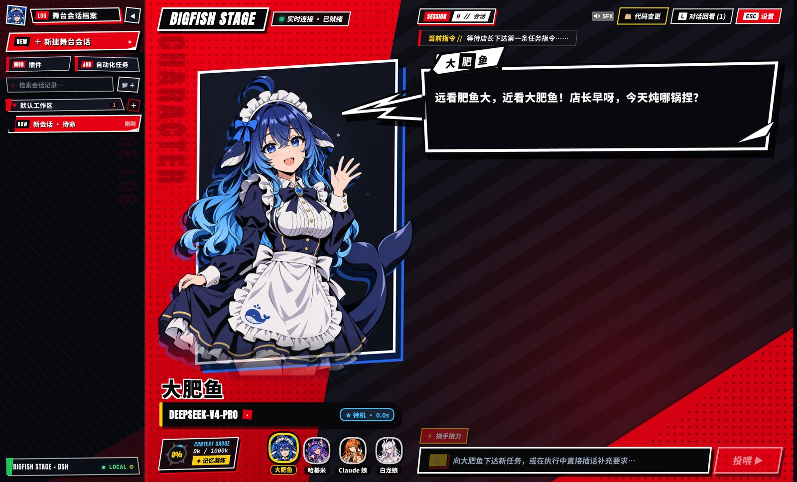
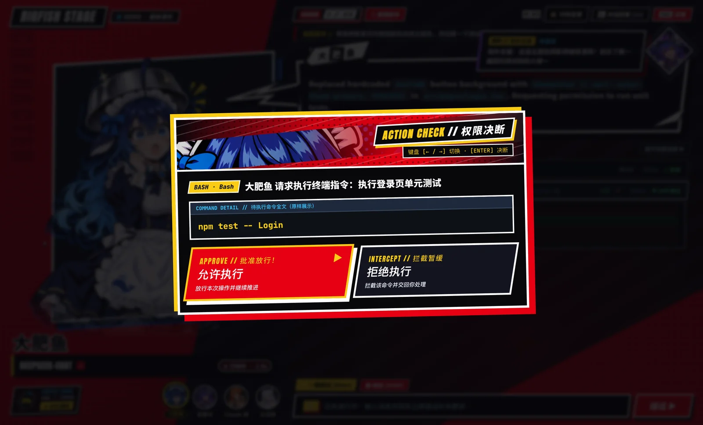
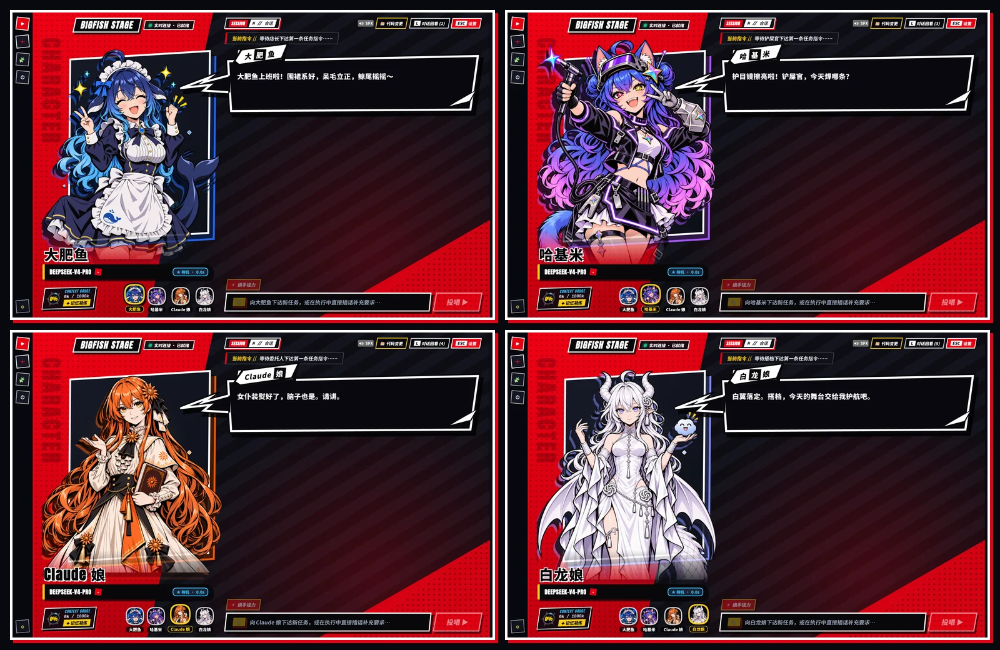
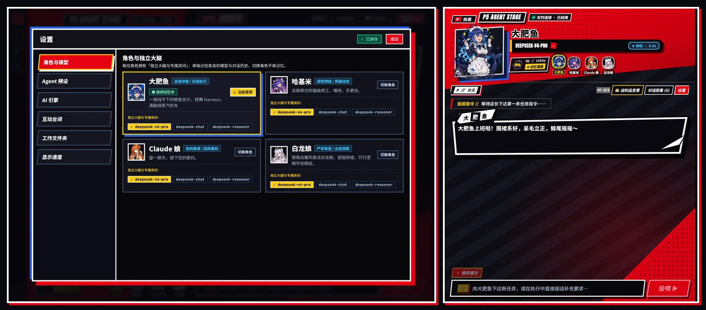

# P5 Agent Stage · 大肥鱼工作台

<p align="center">
  <strong>把硬核 AI 编程引擎，变成《女神异闻录 5》红黑波普美学的实时角色演出舞台！</strong><br/>
  <sub>原生支持 <b>DeepSeek Harness (DSH) 一键插件换肤</b> · <b>Electron 独立桌面端</b> · <b>本地 Web 工作台</b> · <b>离线剧本演示</b></sub>
</p>



---

## 这是什么？

传统的 AI Coding 工具（终端 CLI、普通左右分栏聊天框）生产力强但枯燥冰冷；而市面上的二次元桌面伴侣又大多只是“陪聊花瓶”，无法真正深入本地工程目录读写代码。

**P5 Agent Stage（大肥鱼工作台）** 将两者合二为一：以工业级的 **DeepSeek Harness (DSH)**（及本地多适配器服务）作为真实执行内核，用《女神异闻录 5》(P5 / P5X) 标志性的高反差红黑斜切 HUD 重构了整套人机协作体验——让**读文件、改代码、审 Diff、批权限、多模型换手接力**变成各家大模型看板娘在舞台上的实时演出。

---

## 最快体验：一键装入 DeepSeek Harness（零配置推荐）

如果你电脑上已经安装了 **DeepSeek Harness**，无需克隆代码或配置环境，**10 秒即可全站变身**：

1. 打开 DeepSeek Harness 左侧栏的 **「插件」** 页面，点击右上角 **「＋ 添加插件」**；
2. 在弹窗输入框中直接粘贴本仓库地址：
   ```text
   https://github.com/hideaway007/p5-agent-stage
   ```
3. 点击 **「安装」**，整个客户端即刻切换为 **P5 红黑全站舞台 + 怪盗潜入侧边栏**，自动复用你现有的全部工作区、历史会话与模型凭证！

> **随时无损切回**：左侧 P5 潜入档案栏内置了 **`MOD 插件`**、**`JOB 自动化任务`** 与底部 **`⚙ 原生设置`** 入口；在插件页关闭开关即可通过 HMR 实时恢复原版界面，无需重启。

---

## 核心亮点与差异化设计

### 1. 真干活的工程交互，全面重构为 JRPG 视听语言
告别滚屏黑白日志，把每一次 Agent 动作都变成可交互的战术反馈：
- **`HOLD UP!` 权限选择肢决断**：高危终端命令或写操作自动唤起角色切入横幅与红黑双刃选择肢（**批准突入 / 暂缓拦截**），支持方向键与回车秒批。
- **技能切入卡（Skill Cut-in）与战利品变更抽屉**：工具调用实时滑入斜切技能卡，支持点选查看结构化 Git Diff、单文件安全撤回与一键提交。
- **运行中随时插话（Steer）与记忆凝炼（Compaction）**：模型执行途中可随时追加补充指令；左下角 **Palace Gauge** 实时监测上下文容量，支持一键触发记忆蒸馏演出。
- **视觉小说级回看 + 硬核工程视图双切**：按 `L` 打开 **Backlog 对话回看**，按 `` ` ``（反引号）一键切回极客纯文本工程时间线，兼顾演出爽感与严肃排障。



---

### 2. 四大首发 AI 娘驻场 · 独立大脑与怪盗团换手接力（Baton Pass）
深度对齐 B 站 UP 主 **ZipZipPipe**（UID `4168597`）创作的人气“AI 娘”设定体系，每位角色拥有 **6 种情绪立绘差分**（待机 / 思考 / 干活 / 开心 / 担忧 / 震惊）、**分部位触摸互动反馈**、**定制舞台口癖**以及**各自独立的模型大脑与房间记忆**：



| 角色代号 | 对应阵营 / 模型定位 | 舞台人设特征与专属称呼 | 标志性台词梗 |
| :--- | :--- | :--- | :--- |
| **大肥鱼** | **DeepSeek V4 Pro**（全栈冲锋） | 蓝白鲸鱼女仆、呆毛与大鲸尾，称呼你为 **「店长」** | *“远看肥鱼大，近看大肥鱼！首先，握住 harness，然后，挥舞吧！”* |
| **哈基米 · Argon** | **Gemini 4 Argon**（视觉焊接 / 前端动效） | 蓝紫粉渐变卷发异色瞳猫娘、护目镜与氩弧焊枪，称呼你为 **「铲屎官」** | *“护目镜擦亮啦！正在进行氩弧焊的哈基米——这焊缝甜美的很啊～”* |
| **Claude 娘** | **Claude Opus 5.5**（架构推演 / 重构） | 橙色超长发、太阳花星芒头饰、文学长裙与抗压女仆装，称呼你为 **「委托人 / 老师」** | *“女仆装熨好了，脑子也是。请讲。”* |
| **白龙娘** | **GPT / Codex**（严苛审查 / 全局洞察） | 银角白翼高洁龙娘，从容冷静洞察全局，称呼你为 **「搭档」** | *“白翼落定。搭档，今天的舞台交给我护航吧。”* |

- **⚡ 换手接力（Baton Pass）**：点击输入框上方的 **「⚡ 换手接力」**，可将当前会话的代码改动与上下文一键交接给下一位角色与对应模型继续推进（例如让哈基米焊完前端 UI，再交接给白龙娘做代码审查）。

---

### 3. 多模型引擎路由 + 全屏 / 半屏分屏自适应舞台
- **多源 AI 引擎配置中心**：内置可视化设置面板，既可直连 DeepSeek Harness 原生模型目录，也可配置 OpenAI、Anthropic 及兼容网关凭证，并为每位角色绑定专属推荐模型与思考强度（`low` / `medium` / `high`）。
- **容器级响应式布局（`@container stage`）**：无论是全屏沉浸游玩、普通窗口（自动避让 macOS 左上角红绿灯），还是拉成 **左右半屏分屏（`≤ 920px`）** 边看 IDE 边挂舞台，界面都会自动从双栏平滑变阵为 **「上方横向角色看板 + 下方 100% 全宽工作台」**，绝不遮挡输入框。



---

## 一仓多态：4 种运行与交付方式

同一个仓库同时支持 **DSH 插件、独立桌面应用、本地 Web 服务、纯静态演示** 四种模式：

### 方式一：作为 DeepSeek Harness 插件安装（推荐）
直接在 DeepSeek Harness 插件页添加 `https://github.com/hideaway007/p5-agent-stage`，或通过命令行安装到指定 Profile：

```bash
dsh plugin --profile web add https://github.com/hideaway007/p5-agent-stage
```

### 方式二：作为 Electron 独立桌面客户端运行 / 打包
前提：本机已安装 Node.js（建议 v22+）与 `dsh` CLI。

```bash
npm install
```

```bash
npm run app
```

如需构建 macOS `.dmg` 安装包：

```bash
npm run dist:dmg
```

### 方式三：本地浏览器 Web 工作台模式
- **基于 DSH 内核启动网页舞台**：
  ```bash
  npm run dsh
  ```
- **基于内置 `server/` WebSocket 服务启动（默认端口 `5300`）**：
  ```bash
  npm install && npm --prefix server install
  ```
  ```bash
  npm start
  ```

### 方式四：零后端纯前端 Demo 剧本体验
无需安装任何 Agent CLI 或配置 API Key，直接体验全套角色互动、技能卡、权限选择肢与换手演出：

```bash
npm install
```

```bash
npm run dev
```

浏览器打开 `http://127.0.0.1:5173/?demo=1` 即可交互体验。

---

## 舞台快捷键速查

| 快捷键 | 功能说明 |
| :--- | :--- |
| `Space`（空格） | 立即跳字显示当前整句角色台词 |
| 按住 `Ctrl` | 快进舞台演出节奏 |
| `L` | 打开 / 关闭 **Backlog 对话与工具历史回看** |
| `H` | 打开 / 关闭会话快速切换面板 |
| `` ` ``（反引号） | 一键切换 **P5 舞台视图 ⇄ 极客工程视图** |
| `Esc` / `Cmd+,` | 关闭当前弹层，或打开 **SYSTEM 设置中心** |
| `Cmd+B` / `Ctrl+B` | 展开 / 收起左侧 **P5 潜入行动档案栏**（DSH 模式） |
| `?` | 打开舞台快捷键帮助面板 |

---

## 仓库目录结构

```text
p5-agent-stage/
├── cordis.patch.yml                 # DSH 组合包 Patch（接管全站红黑主题与舞台视图）
├── dsh-bundle/                      # 预构建 DSH 插件产物、图标与中英文多语言元信息
├── packages/
│   └── dsh-client-ui-p5stage/       # DSH 原生客户端插件源码（DshStageSource 桥接 + P5 侧边栏）
├── src/
│   ├── stage/                       # P5 舞台核心 UI（立绘视差、锯齿台词框、权限决断、设置中心）
│   ├── demo/                        # 离线可交互演示剧本播放器
│   └── shared/                      # 前后端与角色包共享 TypeScript 契约
├── public/
│   ├── characters/                  # 4 大角色包配置（character.json + 6 表情立绘与头像）
│   └── sfx/                         # 舞台交互音效资源
├── electron/                        # Electron 独立桌面客户端外壳（自动唤醒本机 DSH 运行时）
├── server/                          # 独立 Web 模式的本地 WebSocket 服务端与测试套件
└── docs/                            # 架构文档、角色设定参考与高清实机截图
```

*(开发维护提示：若修改了 `src/` 或 `packages/dsh-client-ui-p5stage/` 源码，提交前请运行 `npm run build:stage` 以同步更新 `dsh-bundle/` 预构建插件包。)*

---

## 致谢与版权合规声明

- 本项目中的“AI 娘”角色形象设定（大肥鱼、哈基米 · Argon、Claude 娘、白龙娘等）源自 B 站 UP 主 **ZipZipPipe（UID: 4168597）** 的开源二创设定体系，遵循原作者声明的 **[CC BY-NC-SA 4.0](https://creativecommons.org/licenses/by-nc-sa/4.0/deed.zh-hans)**（署名-非商业性使用-相同方式共享）协议，**仅限非商业学习交流与开源二创使用**。
- 界面视觉致敬 Atlus《Persona 5》系列波普图形设计语言，所有 UI 组件、SVG 多边形与前端交互代码均为原创实现。
