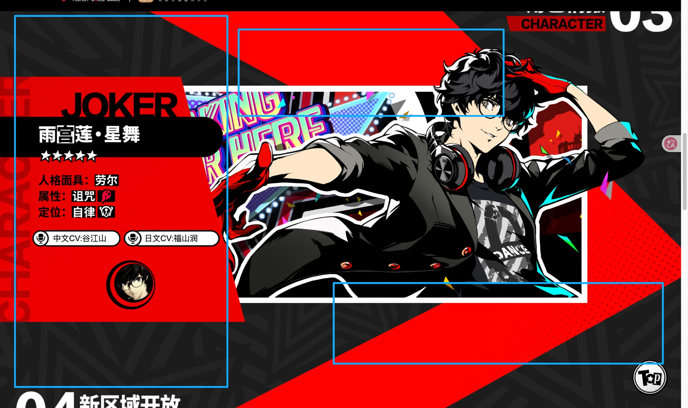

# P5 Agent Stage（AI 娘 × P5 风格 Live2D 舞台）

> **把本地正在跑的 AI Agent 会话，变成 P5 视觉风格 × B站人气“AI 娘” Live2D 角色的实时互动舞台！**



---

## 核心产品定位（v0.2 校准版）

1. **连接本地正在跑的 Agent 对话（Local Session Bridge）**
   - 实时接入本地正在运行的 CLI / Agent 会话（Claude Code / Opus 5.5、Gemini 4 Argon、Codex、DeepSeek、Zcode 等），把枯燥的终端日志流转化为角色在舞台上的实时互动演出。
2. **正统“AI 娘”角色宇宙（基于 ZipZipPipe 人设图谱）**
   - 完整对齐《[AI娘人设整理_配图版.pdf](./docs/AI娘人设整理_配图版.pdf)》（来源：B站 ZipZipPipe UID 4168597 二创体系）：
     - **Gemini 娘（「哈基米」· Gemini 4 Argon 氩弧焊版）**：蓝紫粉渐变长卷发异色瞳猫娘，头戴焊工护目镜、手持氩弧焊枪、周身环绕淡紫色氩气辉光霓虹带。
     - **Claude 娘（Opus 5.5 / 女仆装 / Fable 5 / Claude Code 娘）**：橙色超长发、太阳花形星芒头饰、米白橙黑长裙/女仆装、手捧书本望天思考的知性少女。
     - **大肥鱼 & 小肥鱼（DeepSeek V4 Pro / Flash & Harness 娘）**：深蓝渐变发、鲸鳍耳与大鲸尾的“傻敷敷”女仆看板娘（举着 `max/low` 牌子、把 Harness 娘当武器挥舞）。
     - **Codex 娘**：闭眼困倦的淡蓝白发小个子龙娘，穿宽松睡衣与毛绒拖鞋，手拿 `>_` 便签。
     - **GLM 娘 / Zcode 娘**：头推「Z」字眼罩的哥特腹黑狐娘，与怀抱 A0 工程图纸的蒙眼工程师狐娘。
3. **Live2D 角色驱动（`PixiJS` + `Cubism Web SDK`）**
   - 角色采用 **Live2D** 渲染而非静态死图：支持**鼠标视线跟随**、**猫耳/鲸尾/长发物理摆动**、**分部位触摸反馈（HitAreas）**、**流式输出实时口型同步（LipSync）**，以及随本地任务状态自动切换动作（`.motion3.json`）与表情（`.exp3.json`）。
4. **P5 风格高反差 HUD 与弹性对话框（暂定布局、自由演进）**
   - 整体采用《女神异闻录 5》(P5) 的红黑斜切波普美学；参考图中的“左角色卡、上台词气泡、右下聊天输入”仅作为**当前暂定的大致方位示意**，对话框的具体位置、形态、多气泡展开或浮动布局不做死板限制，随实际交互体验灵活迭代。

---

## 首发与扩展角色一览

| 角色代号 | 对应模型 / 工具 | 种族 / 核心视觉特征（源自人设集） | 标志性人设梗与口癖 |
| :--- | :--- | :--- | :--- |
| **哈基米 · Argon** | **Gemini 4 Argon** | **猫娘**：蓝→紫→粉渐变卷发、猫耳猫尾、红/黄异色瞳、四角星闪光；头戴焊工帽/护目镜、手持**氩弧焊枪**、淡紫氩气霓虹光带 | *“正在进行氩弧焊的哈基米——这焊缝甜美的很啊～”* |
| **Claude 娘** | **Opus 5.5 / Claude Code** | **文学/女仆少女**：橙色超长发、橙色太阳花形头饰、米白+橙黑长裙/女仆装、手持书本（另有古希腊白袍卷轴 `Fable 5` 形态） | *“抬头望天，似乎正在思考着什么……反正我早有准备，换上女仆装继续干活了。”* |
| **大肥鱼** | **DeepSeek V4 Pro** | **鲸鱼娘**：深蓝渐变卷发、呆毛、下垂鲸鳍耳、深蓝鲸尾、小鲸鱼围裙女仆装（另有宫廷侍女装 & 小肥鱼 V4F） | *“远看肥鱼大，近看大肥鱼，鱼之大，一锅炖不下。”* / *“握住 Harness 娘，然后挥舞吧！”* |
| **Codex 娘** | **OpenAI Codex** | **小龙娘**：淡蓝白长卷发、小龙角、**闭眼困倦状**、白色宽松睡衣连衣裙、毛绒拖鞋、手拿 **`>_` 便签** | *“唔……别吵，拿着 `>_` 便签梦游写代码也是能跑通的……”* |
| **Zcode / GLM 娘** | **Zcode CLI / GLM** | **狐娘**：白发蒙眼工程师狐娘（抱 841×1189mm A0 图纸、插尺子扳手）/ 黑发蓝挑染哥特狐娘（头推 Z 字眼罩、架狙击枪） | *“作为一个工程级的 coding 程序，工程师就应该报 A0 图纸！”* |

*(注：根据原作者声明，大肥鱼等形象遵守 **CC BY-NC-SA 4.0** 协议，仅限非商业交流与二创使用。)*

---

## 目录结构

```text
p5-agent-stage/
├── docs/
│   ├── DESIGN.md                    # 产品开发文档 v0.2（弹性 HUD + AI娘人设库 + Live2D 架构）
│   ├── AI娘人设整理_配图版.pdf       # 完整 28 页 AI 娘图文设定集（ZipZipPipe 体系）
│   └── p5-layout-reference.webp     # P5X 界面大致方位参考图（暂定状态）
├── src/
│   ├── characters/
│   │   └── roster.ts                # AI 娘角色设定、Live2D 模型/动作/表情/触摸热区配置
│   ├── bridge/                      # 本地 CLI 会话（Claude Code / Gemini / Codex）事件桥接
│   └── ui/                          # P5 风格弹性对话框与 Live2D 画布容器
└── public/
    └── live2d/                      # 各角色 Live2D 模型资源 (.model3.json / .moc3 / physics / motions)
```
