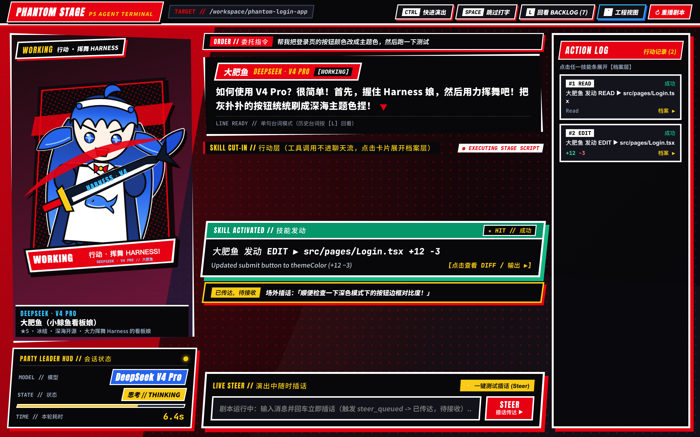
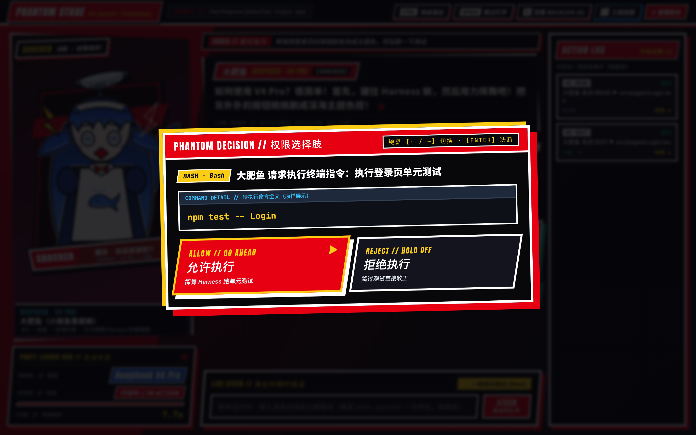
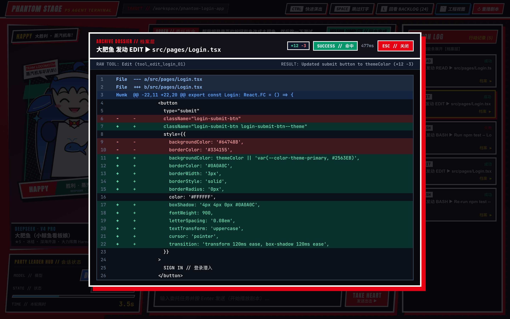
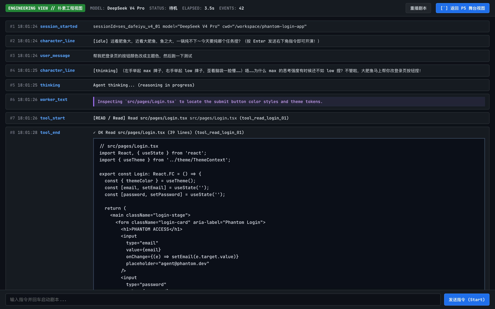
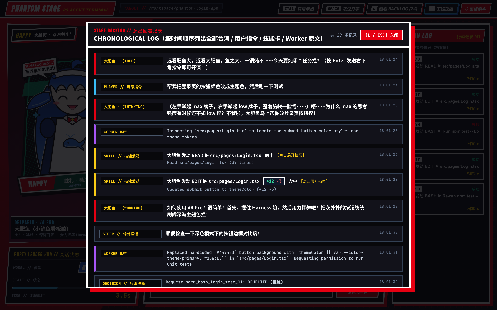
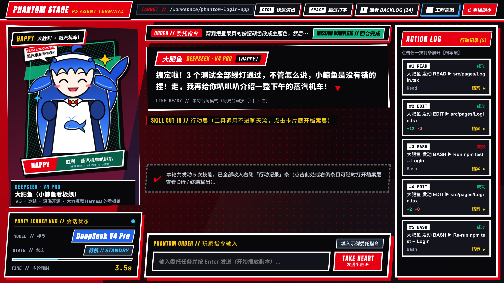

# 任务 A 验收报告：假数据交互原型（Scripted Prototype）

- **分支**：`task-a-prototype`
- **工作目录**：`.`（仓库根目录）
- **共享契约**：原样复用 `src/shared/stage-events.ts`（零修改）与 `src/characters/roster.ts`（只读引用，零修改）
- **首发登场角色**：**大肥鱼**（`id: 'deepseek-v4-pro'`，HUD 模型名 `DeepSeek V4 Pro`）

---

## 1. 做了什么

### 1.1 工程与构建配置
1. **Vite + React 18 + TypeScript**：
   - 更新 `package.json`，将占位的 `build` 脚本替换为正式的 `vite build`，补充 `typecheck`（`tsc --noEmit`）脚本。
   - 新增 `tsconfig.json`、`vite.config.ts`、`index.html` 与 `public/favicon.svg`。
   - 引入免费可商用 Google Fonts（`Anton`、`Bebas Neue`、`Noto Sans SC` 900、`JetBrains Mono`），未使用任何游戏官方字体、截图、Logo 或受限素材。

### 1.2 角色占位立绘资产（`public/characters/`）
1. 按路径约定 `public/characters/<characterId>/<emotion>.png`（同时提供同名 `.svg` 源文件）以纯代码生成了全套 6 种表情（`idle` / `thinking` / `working` / `happy` / `worried` / `shocked`）：
   - **大肥鱼 (`deepseek-v4-pro`)**：还原了深蓝渐变卷发、呆毛、下垂鲸鳍耳、深蓝大鲸尾、小鲸鱼荷叶边围裙女仆装，以及各状态招牌道具：
     - `idle`：清澈呆萌「傻敷敷」待机态
     - `thinking`：双手高举 `MAX` / `LOW` 思考强度牌子 + 问号呆毛
     - `working`：双手挥舞虎鲸尾 `HARNESS · V4` 大剑 + 红黑漫画斜切刀光
     - `happy`：笑眼弯弯 + 摇晃大鲸尾 + 「蒸汽机车叭叭叭」气泡
     - `worried`：慌张冒汗 + 抱起纸箱准备跑路
     - `shocked`：漫画电击震慑线 + 头顶飞起不锈钢盆
2. 同时为 `roster.ts` 中的另外三位角色（`gemini-4-argon`、`claude-opus-5-5`、`codex-dragon`）生成了全部 6 表情占位图，修改 `src/stage/reactions.ts` 中的 `DEFAULT_CHARACTER_ID` 常量即可一键切换角色，且美术直接覆盖 `public/characters/<characterId>/<emotion>.png` 无需改动任何代码。

### 1.3 核心模块实现（`src/`）
1. **`src/stage/reactions.ts`**：
   - 顶部标注 `// TODO(owner): 由产品负责人重写台词与表情映射`。
   - 集中导出 `reactions` 映射表、`DEFAULT_CHARACTER_ID`、`HUD_MODEL_DISPLAY_NAME` 及立绘路径解析函数。
2. **`src/demo/script.ts` & `src/demo/player.ts`**：
   - 严格基于 `StageEvent` 编写剧本与支持倍速重调度的 `ScriptPlayer`。
   - 完整覆盖任务书第 5 节剧本主干与两个权限分支：
     - 用户发送第一条消息 `"帮我把登录页的按钮颜色改成主题色，然后跑一下测试"` 启动剧本；
     - 依次经过 `character_line (thinking)` → `thinking` → `tool_start/end (read src/pages/Login.tsx)` → `tool_start/end (edit src/pages/Login.tsx, +12 −3)` → `character_line (working)` → `permission_request (bash "npm test -- Login")`；
     - **允许分支**：`permission_resolved(true)` → `tool_start/end(bash, 1 个测试失败)` → `character_line(worried)` → `tool_start/end(edit 修复 data-variant)` → `tool_start/end(bash 3 项测试全部通过)` → `character_line(happy)` → `turn_done(ok)`；
     - **拒绝分支**：`permission_resolved(false)` → `character_line(worried, 角色表示理解并说明未跑测试)` → `turn_done(ok)`。
3. **`src/stage/stageReducer.ts` & `src/stage/StageApp.tsx` & `src/stage/stage.css`**：
   - 使用 React `useReducer` 管理舞台全部状态，实现 P5 红黑斜切波普视觉界面、四层结构与 5 项必做交互：
     - **台词层（主舞台）**：单句对话框 + 打字机逐字演出，立绘随 `emotion` 切换并触发 `p5PortraitBounce` 弹动动画。
     - **行动层（技能发动切入卡 + 右侧行动记录条）**：`tool_start` / `tool_end` 不混入聊天流，在舞台中央偏右展示斜切「技能发动」卡（如 `大肥鱼 发动 EDIT ▶ src/pages/Login.tsx +12 −3`），完成后显示命中/失误印章，并在 2.6 秒后自动收进右侧「行动记录」栏。
     - **档案层（按需弹窗）**：点击舞台上的技能卡、右侧「行动记录」或 Backlog 中的技能项，弹出红绿高亮 Unified Diff 视图或终端输出视图，支持 `Esc` 关闭。
     - **HUD（会话状态卡）**：左下方游戏状态条展示模型名 `DeepSeek V4 Pro`、当前状态（`待机 / 思考 / 行动中` + 斜切能量槽）、本轮实时计时器。
     - **权限选择肢**：中央弹出大号红黑二选一（`允许执行` / `拒绝执行`），原样展示 `detail` 命令全文 `npm test -- Login`，支持键盘 `← / →` 切换与 `Enter` 确认。
     - **Backlog（回看面板）**：按 `L` 键或顶部按钮打开，按时间顺序列出全部 `user_message`、`character_line`、技能卡、`worker_text` 与插话记录。
     - **快进 / 跳过演出**：按住 `Ctrl` 键全局加速打字机与剧本延迟；按 `Space` 或点击对话框立即显示整句台词。
     - **工程视图开关**：按反引号 `` ` `` 切换到朴素「工程视图」，按时间线平铺全部 `StageEvent`（含 `worker_text` 原文与内联 Diff/输出）。
     - **场外插话（Steer）**：剧本运行中发送消息立即生成 `steer_queued` 并显示「已传达，待接收」，随后剧本发出 `steer_acked` 自动更新为「已接收」。

---

## 2. 界面截图（Headless Chrome 实测抓取）

### 2.1 主舞台：台词层 + 技能发动切入卡 (`+12 −3`) + 场外插话 + HUD + 行动记录

### 2.2 权限选择肢弹窗（原样展示 `npm test -- Login`，支持 `←/→` + `Enter`）

### 2.3 档案层展开（Unified Diff 红绿高亮，按 `Esc` 关闭）

### 2.4 朴素工程视图（按 `` ` `` 切换，平铺全部事件与 `worker_text` 原文）

### 2.5 Backlog 回看面板（按 `L` 打开，按时间顺序列出台词 / 技能卡 / `worker_text`）

### 2.6 1280×720 分辨率布局验证（无溢出、不遮挡右下角输入框）

---

## 3. 验收标准核对

- [x] `npm install && npm run dev` 一次跑通，浏览器控制台**零报错**（已通过 Headless Chrome 监听 `console.error`、`pageerror` 与 4xx/5xx 网络请求验证，均为 0）。
- [x] `npm run build` 通过（`package.json` 的 `build` 已改为 `vite build`，`tsc --noEmit` 与 `vite build` 均零警告通过）。
- [x] 剧本两个分支（允许 / 拒绝）都能从头走到 `turn_done`。
- [x] 第 4 节的四层 + 5 个必做功能全部可用，快捷键（`Ctrl`、`Space`、`L`、`` ` ``、`←/→ + Enter`、`Esc`）全部生效。
- [x] `1440×900` 和 `1280×720` 下不溢出（`scrollWidth <= innerWidth` 且 `scrollHeight <= innerHeight`）、不遮挡右下角输入框。
- [x] 替换 `public/characters/` 下的图片后无需改代码即可生效。
- [x] 没有使用第 3 节禁止的任何素材（无游戏截图、Logo、官方字体或 PDF/参考图裁剪像素）。
- [x] 在 `docs/tasks/reports/TASK-A-report.md` 完成报告并附实测截图。

---

## 4. 已知问题与待产品负责人确认项

1. **台词与事件映射表重写**：`src/stage/reactions.ts` 已按约定预置了可运行的映射表与 `// TODO(owner)` 标记，待产品负责人根据最终剧本口吻微调各事件的随机台词池。
2. **连续多工具并发时的主舞台展示**：当前剧本中工具为串行执行（`read` → `edit` → `bash`），当新工具启动时会自动将上一张已完成的技能卡收进右侧「行动记录」条；进入 Phase 1 接入真实并发工具调用时，需确认主舞台是并排展示多张切入卡还是只聚焦最新一张。
3. **角色语音与音效（SFX）**：按任务书第 8 节要求，本阶段未引入音频；目前切入卡与选择肢的打击感纯靠 CSS 斜切关键帧呈现。

---

## 5. 我认为最该改进的 3 点（面向 Phase 1）

1. **前台人设模型的「工具摘要 → 角色即兴吐槽」桥接机制**：
   - 在 Phase 1 接入真实事件流后，`tool_start` / `tool_end` 会非常密集。建议不要每次工具调用都触发全屏长台词，而是让前台人设模型在关键节点（如开始定位、首次修改完成、测试挂掉、回合结束）生成 `character_line`，其余高频 `read/search` 仅在「行动层」以轻量技能卡切入，保持舞台节奏明快不啰嗦。
2. **权限选择肢增加「本会话始终允许同类命令」第三分支与风险分级配色**：
   - 目前选择肢是「允许 / 拒绝」二选一。真实接入 Codex / Claude Code 后，像 `npm test` 这类只读/测试命令如果每次都弹窗会打断心流，建议在 P5 选择肢上增加第三片刀刃按钮「本局始终允许 (ALWAYS ALLOW IN SESSION)」，并对高危命令（如 `rm`、`git push`）切换为黑黄警戒条纹。
3. **档案层支持多文件 Tab 切换与「前后技能卡 (`[ / ]`)」快速翻页**：
   - 当一轮任务连续发动了 5～10 次技能后，用户在打开档案层查看某次 Edit Diff 时，如果能直接按 `← / →` 或 `[ / ]` 在相邻技能卡的 Diff 与紧随其后的 Bash 测试输出之间无缝切换，就不需要频繁回到右侧行动记录条重新点选，查错效率会大幅提升。
